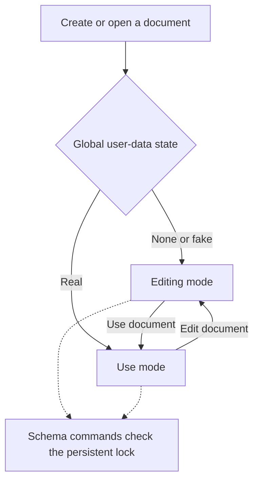

# Document data, modes, and schema lifecycle (2026-10-18)

This is the high-level contract for a SubCard stack. Storage and policy are shared
by SwiftUI (macOS/iOS) and GPUI. The detailed editing experience, use experience,
card layouts, ER diagram editor, and record-entry workflows will be designed in
later steps.

## System tables and user tables

A document is one SQLite database containing two logical areas:

- **System tables** support the application: document content, lifecycle metadata,
  and, later, card/interface definitions and other application-owned structures.
  Their rows never count as user data.
- **User tables** implement the document's own entity/relationship schema and
  contain its records. Their schema belongs to the document, rather than being
  the same fixed schema for every SubCard file.

The existing `document` table and its Hello World text are system content. Editing
that prototype field does not create a user record or lock the user schema.
The present storage boundary reserves lowercase `user_` as the prefix of every
user table and explicit user index; all other existing tables remain outside the
user-data area. Relationships must reference existing user tables. The prefix is
an internal storage convention, not a constraint on future entity display names.

## Three exclusive, global data states

**Fake versus real is one global state for all user tables in a document.**
There is no per-table or per-record provenance setting. When the global state is
Fake, every user table belongs to the fake-data set. When it is Real, every user
table belongs to the real-data set. Individual tables may have zero rows; that
does not give them a different classification. None means there are no rows in
any user table.

| Current user rows across the entire document | Global state | Mode on open | User schema |
| --- | --- | --- | --- |
| None, never held real rows | None | Editing | Editable |
| Fake/sample rows | Fake | Editing | Editable; fake rows can be discarded |
| Real rows | Real | Use | Locked |
| None, previously held real rows | None | Editing | Still locked |

The last row makes two separate requirements explicit: the current rows choose
the opening mode, while the history of real data determines the permanent lock.
The first application version has **no user-schema migration**. Deleting the
last real record must not accidentally enable destructive schema changes.

Persisting fake data does not make it real. Fake and real rows must never coexist,
including in different user tables. To start real use from a fake-data document,
explicitly discard all fake rows first, retaining the schema. There is currently
no implicit promotion of fake rows into real records. Returning from real use to
editing also never relabels real records as fake.

## Mode is session state; the lock is document state



On creation there are no user tables or rows, the user schema is unlocked, and
the session starts in editing mode. On every open the backend reads the global
data state and chooses the mode using the table above. The last mode selected in
a previous session is not saved. Switching modes does not change data provenance,
schema permissions, or the document's dirty state.

A use-mode session can always return to editing mode. Real data does not prevent
all document editing: it prevents changing the **user schema**. System-owned
design content remains a separate concern. Future editing features must check
their own operation's policy instead of treating editing mode as blanket
permission to change user tables.

For now, both directions of the mode switch are available even with no real
data. This leaves room for previewing a design with empty or fake data. Inserting
the first real rows locks the schema immediately but does not force a session
mode change; reopening a document containing real rows selects use mode.

## Shared commands and invariants

`backend/src/UserData.cpp` owns the user-storage commands and lifecycle rules;
`Document.cpp` owns working-copy persistence, session mode, and dirty tracking.
The C API exposes the same operations to every frontend:

| Operation | Required state | Result |
| --- | --- | --- |
| Read global data kind / lock / mode | Valid document | Shared authoritative state |
| Change mode | Editing or use | Session changes; data and lock stay unchanged |
| Replace user schema | Editing and unlocked | Replace all user tables/indexes; discard all fake rows; global state becomes None |
| Write fake rows | Editing and unlocked; None or Fake | Global Fake if any rows remain, otherwise None |
| Discard fake data | Editing, unlocked, Fake | Delete fake rows from all user tables; preserve schema; global state becomes None |
| Write real rows | None or Real | Global Real if rows remain, otherwise None; successful real writes latch the lock |

Schema replacement is deliberately explicit and complete in this first storage
implementation. It allows ordinary `CREATE TABLE` and `CREATE INDEX` statements
for the user area. The future ER layer can generate those definitions; no ER
serialization, schema-diff model, or migration engine is chosen here. Replacing
an empty/fake schema can remove/recreate its tables because it contains no real
records. Once locked, even an identical replacement is rejected.

The user-data primitive accepts a global fake/real classification and a batch of
`INSERT`, `UPDATE`, or `DELETE` statements. Read subqueries are allowed within the
user area. A SQLite authorizer prevents these batches from altering schema,
writing system content, changing metadata/PRAGMAs, controlling transactions,
attaching databases, or creating executable schema such as triggers, views, and
virtual tables. Schema commands cannot insert user records. This is an internal
storage primitive for later typed application commands, not a user-facing SQL
console or scripting API. Only a small set of basic SQL functions is enabled.

Every schema/data command runs as one SQLite transaction, including global
provenance and lock updates. Foreign keys are enabled, checked at commit, and
deferred for the duration of the command, so related tables can be changed as one
batch. A failed command rolls back the schema, rows, and metadata together and
leaves the cached state and dirty baseline unchanged. A successful batch that
inserts and then deletes real rows still conservatively latches the schema lock;
an empty update that matches no rows does not latch it.

## Persistence and compatibility

The version-1 document format gains an application-owned singleton:

```sql
CREATE TABLE subcard_system_state (
    id INTEGER PRIMARY KEY CHECK (id = 1),
    data_kind INTEGER NOT NULL CHECK (data_kind BETWEEN 0 AND 2),
    schema_locked INTEGER NOT NULL CHECK (schema_locked IN (0, 1)),
    CHECK (data_kind != 1 OR schema_locked = 0),
    CHECK (data_kind != 2 OR schema_locked = 1)
) STRICT;
-- data_kind: 0 = none, 1 = fake, 2 = real; one row for the whole document
```

The backend validates the singleton, actual row presence across all user tables,
supported schema objects, and relationships on open. Inconsistent state fails
instead of silently unlocking a schema or guessing whether rows are fake.

Original version-1 greeting documents have no lifecycle singleton and no `user_`
tables. They are interpreted as empty/unlocked and receive system defaults in
the in-memory working copy. Opening leaves the source file unchanged and clean;
the defaults are included in the next save after an edit. A file with user
tables but no lifecycle metadata is rejected. No existing user schema or user
data is converted. Unrelated extra tables/resources remain preserved by the
full-database backup/snapshot mechanism.

Schema and data commands mark the document changed independently of the prototype
text field. Dirty tracking compares the saved text and the revision of successful
schema/data commands. Reverting text alone clears its text changes, but cannot
clear unsaved schema/data changes. These commands currently have no undo model;
recreating an earlier schema/data value still counts as an unsaved command.
Save, Save As, and iOS snapshot exports include all rows and lifecycle metadata.
Snapshot acceptance records both the text and revision that were actually
written, so later schema/data changes stay dirty and locked where applicable.

## Frontends and next steps

SwiftUI on macOS/iOS and GPUI display the core's current mode, offer a simple
Edit document / Use document switch, and indicate when the user schema is locked.
The existing text editor remains a prototype in either mode. Mode-specific
surfaces and permissions beyond the schema/data contract are intentionally
deferred. There is currently no frontend ER editor, fake-data generator, user
record editor, or user-data SQL console.

Future features must call the shared command boundary for user schema/data
changes. UI button disabling alone cannot enforce the lock. Later decisions
include ER representation and supported field types, fake-data generation,
record navigation/entry, card layout, scripting, and detailed mode presentation.
A future migration feature would require a separate, explicit design before
relaxing the schema lock.

## Verification

`./scripts/test.sh` runs the original persistence tests plus
`tests/document_architecture_tests.cpp`. The latter checks empty/fake/real
opening modes, transient mode changes, global fake/real exclusivity across user
tables, atomic fake-data discard/schema replacement, blocked system/schema writes,
relationship failure rollback, immutable schema after real data (including after
deleting all real rows), failed saves, save/reopen, legacy defaults, inconsistent
metadata, and snapshot acceptance after later user-data changes.

The macOS SwiftUI and GPUI apps and the unsigned arm64 iPhone target were rebuilt
for this change. Both macOS apps were checked through their controls: a new
document starts in editing mode, switching modes keeps it clean, and the same
real-data fixture opens in use mode with the schema locked. Returning to editing
preserves the lock in both apps. The iPhone binary still targets iOS 16.0 and has
only system runtime dependencies. Linux/Windows and physical-iPhone runtime
interactions were not validated for this change.

## Dropdown defaults

[Managed dropdown choices](dropdown-fields.md) are design defaults. They do not
count toward fake/real provenance or lock the schema. System templates repopulate
their user tables after schema replacement and fake-data discard. Direct user-data
writes cannot modify these managed tables. Real ordinary data locks their design
under the same permanent schema-lock policy as other field definitions.
